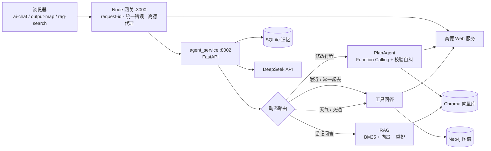

# 行界 WanderAI · 智能旅行规划助手

输入目的地、天数和偏好，生成**每个地点都真实存在、交通时长可执行**的行程，并在地图上展示；之后可以继续用聊天追问、修改行程。

2025 百度文心黑客松参赛项目，赛后独立重构为可评测、可容错的版本（重构过程见 [docs/upgrade_plan.md](docs/upgrade_plan.md)）。

## 功能

| 能力 | 做法 |
|---|---|
| **Agent 行程规划** | Function Calling 循环编排游记检索、高德 POI / 路线 / 天气等工具，以结构化 JSON 提交行程；规则校验器检查地点真实性、城市一致、相邻两站 ≤60 分钟、每日 ≤12 小时，不通过的问题回填给 LLM 自行修正 |
| **混合检索 RAG** | 地名过滤 + BM25（jieba）与 bge 向量的 RRF 融合 + bge-reranker 重排，基于 217 篇游记回答经验类问题并标注引用 |
| **知识图谱** | 游记中的地点对齐到高德 POI，存入 Neo4j（共现、邻近、所属关系）；“附近有什么”“去了 A 还去哪”类问题通过参数化 Cypher 模板查询 |
| **动态路由** | 聊天消息按 5 类意图分发：修改行程 / 游记问答 / 地点关系 / 天气与交通 / 闲聊；本地 RoBERTa 路由模型置信度不足时交给 LLM |
| **长期记忆** | 记住同行人、饮食、行动限制、预算、喜好等 8 类信息并在规划时遵守；写入时校验证据必须出自用户原话，过滤敏感信息，支持改口覆盖 |
| **工程化** | 统一错误码与用户提示语；LLM / 高德 / 图谱客户端均有超时、按错误类型重试、熔断与并发控制，任一依赖失败时逐级降级；request-id 全链路追踪；配置外置 |

## 架构



## 评测结果

下表的数字都可以用 `eval/` 下的脚本复现，报告在同一目录。

| 场景 | 对比 | 结果 | 报告 |
|---|---|---|---|
| 行程可执行性 | 旧流程（文本生成 + 正则解析）vs Agent，同批 20 个需求 | 超过 60 分钟的路段 22.3% → **0%** | [agent_report](eval/agent_report.md) |
| 校验自纠 | 首次提交 vs 自纠后 | 通过率 80% → **100%** | 同上 |
| 动态路由 | 每句都重新规划 vs 按意图分发，40 条人工消息 | 延迟 14.5s → **5.3s**，token -80%，误改行程 17/32 → **0/32** | [router_report](eval/router_report.md) |
| 长期记忆 | 不带记忆 vs 带记忆，6 个场景 × 3 轮 | 违反用户约束 14/18 → **3/18** | [memory_report](eval/memory_report.md) |
| 知识图谱 | 只用高德周边搜索 vs 加图谱，16 个问题 × 3 次 | 有游记依据的推荐 2.2 → **5.3** 个，延迟 -33%，token -23% | [graph_report](eval/graph_report.md) |
| 实体对齐 | 三轮人工抽检，每轮重新抽样 | 精确率 70% → **82%~88%** | [alignment_review](eval/graph_alignment_review.md) |

检索指标（nDCG / Recall / MRR）的相关性标注由 LLM 完成，人工抽检完成前不列出，见 [rag_report](eval/rag_report.md)。

## 快速开始

需要 Node 18+、Python 3.10+、[DeepSeek API Key](https://platform.deepseek.com/)（或任意 OpenAI 兼容服务）和[高德 Web 服务 Key](https://console.amap.com/)。

```bash
cp .env.example .env          # 填入 LLM_API_KEY、AMAP_WEB_SERVICE_KEY
npm install

cd agent_service
python -m venv .venv-win
.venv-win/Scripts/pip install -r requirements.txt
.venv-win/Scripts/python ingest_csv.py --csv ../data/travel_notes.csv --reset   # 游记入库（向量库）
.venv-win/Scripts/python app.py                                                # Python 服务 :8002
```

另开一个终端：

```bash
npm start                     # 网关 :3000，浏览器打开 http://localhost:3000/
```

可选组件：

- **知识图谱**：在 `.env` 设置 `NEO4J_PASSWORD`，执行 `docker compose up -d neo4j`，然后在 `agent_service` 目录下运行 `python -m graph.build --reset`。不启用时，地点关系类问题自动改用高德周边搜索。
- **本地分类模型**：模型文件体积较大，没有放进仓库。按 [agent_service/README.md](agent_service/README.md#意图分类) 训练后放到 `agent_service/models/`；缺少模型时自动改用 LLM 分类。

健康检查：`GET /api/readyz`，会列出 LLM、向量库、分类模型、图谱各自的状态。

## 目录

```text
server.js                 Node 网关
ai-chat.html 等           前端页面
agent_service/
  core/                   配置、日志、错误码、LLM / 高德客户端、重试与熔断
  agent/                  PlanAgent、工具、校验器、动态路由、工具问答
  rag/                    分块、入库、元数据抽取、BM25、重排、混合检索
  graph/                  实体对齐、建图、Cypher 模板、Neo4j 客户端
  memory/                 长期记忆、会话摘要
  classifier/             风格 / 路由分类模型与训练脚本
  tests/                  pytest 用例
eval/                     评测脚本与报告
docs/                     升级规划与设计说明
```

## 文档

- [project_documentation.md](project_documentation.md)：模块说明、配置、接口、已知问题
- [agent_service/README.md](agent_service/README.md)：Python 服务的安装、入库、训练与测试
- [docs/upgrade_plan.md](docs/upgrade_plan.md)：从参赛版本到当前版本的分阶段改造

## 局限

- 游记语料只有 217 篇，图谱中多数地点只被 1 篇游记提到。
- 没有登录体系，记忆按浏览器生成的匿名 ID 隔离，仅适合演示。
- 一次 Agent 规划约 30~50 秒；高德个人 Key 有 QPS 和日配额限制。
